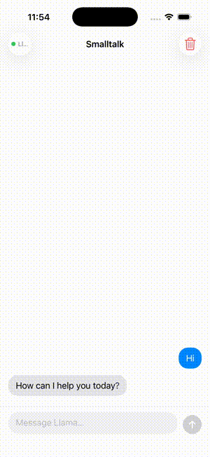

# Smalltalk — SwiftUI chat client for a locally hosted LLM

A SwiftUI iOS **client** that streams chat responses from [Ollama](https://ollama.com/) running on a Mac. It uses Swift 5.9 observation, MVVM, `URLSession`, and Ollama's newline-delimited JSON streaming API.

> **Scope and limitations:** The LLM does **not** run on the iPhone. The iOS Simulator connects to an Ollama service running on the development Mac at `http://localhost:11434`. This is a local prototype, **not** a production-ready iOS app. It currently has no persistent message history, no iOS-device endpoint configuration, and no transport security/authentication for a remote Ollama server.



## Features

- Token-by-token streaming into a SwiftUI chat interface
- Async networking and streaming with `URLSession` and `AsyncThrowingStream`
- SwiftUI MVVM state management with `@Observable`
- Model availability check and error display
- In-memory conversation history and clear-chat action
- No external Swift dependencies

## Requirements

- macOS with Xcode 15+ (iOS 17 / Swift 5.9)
- [XcodeGen](https://github.com/yonaskolb/XcodeGen) to generate `Smalltalk.xcodeproj`
- Ollama installed **on the Mac** with the `llama3.2` model
- An iOS Simulator running on the same Mac (the app's fixed localhost endpoint is for Simulator use)

## Run locally

```bash
git clone https://github.com/Daisysuyin/smalltalk.git
cd smalltalk
brew install xcodegen
xcodegen generate
ollama pull llama3.2
```

Start the Ollama application/service if it isn't already running. In a separate terminal verify:

```bash
curl http://localhost:11434/api/tags
```

Open the generated project:

```bash
open Smalltalk.xcodeproj
```

Select an **iOS 17+ Simulator** and press **Cmd+R**. The project is generated from the checked-in `project.yml`; the `.xcodeproj` file is intentionally not tracked.

> On a physical iPhone, `localhost` refers to the **phone**, not your Mac. The current implementation requires endpoint configuration, a trusted transport, and network permissions before phone deployment. Do not expose an unauthenticated Ollama server to the public internet.

## Architecture

```text
ChatView.swift           SwiftUI UI and conversation display
        |
ChatViewModel.swift      @Observable UI state, send and stream flow
        |
Networking.swift         InferenceEngine -> Ollama HTTP /api/tags and /api/chat
        |
Models.swift             Message and model state types
SmalltalkApp.swift       App entry point
```

`Networking.swift` uses `URLSession.shared.bytes(for:)` and parses Ollama NDJSON streaming lines. Conversation history is currently in memory only, and `clearChat` resets the UI state.

## Validation

To check the generated iOS project on macOS with Xcode:

```bash
xcodegen generate
xcodebuild -project Smalltalk.xcodeproj -scheme Smalltalk \
  -sdk iphonesimulator -destination 'generic/platform=iOS Simulator' \
  CODE_SIGNING_ALLOWED=NO build
```

GitHub Actions uses the same generation and simulator build commands. A passing build does **not** verify that Ollama is running or that live chat succeeds.

## Future work

- Persist messages between app launches
- Allow safe configurable Ollama endpoints for physical devices
- Add UI / networking tests and a simulated streaming transport
- Harden cancellation and error handling for connection loss
- Add model selection and multi-conversation support

## License

MIT. See [LICENSE](LICENSE).
